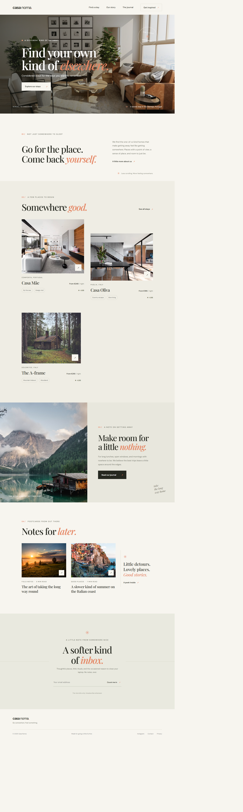

# Casa Noma

A responsive, editorial-style landing page for a collection of thoughtful, one-of-a-kind stays.

## Preview



## Run locally

No build step or dependencies are required. Open `index.html` in a browser, or serve this folder with any static file server:

```bash
python -m http.server 8000
```

Then visit [http://localhost:8000](http://localhost:8000).

## Files

- `index.html` — Page structure, content, and metadata.
- `styles.css` — Responsive layout, visual styling, and reduced-motion support.
- `script.js` — Mobile navigation and newsletter form feedback.
- `screenshot.png` — Full-page desktop preview.

## Notes

The photography is loaded from Unsplash and the typefaces from Google Fonts, so an internet connection is needed for the complete visual treatment. The newsletter form is a front-end demonstration and does not submit data to a mailing list.
